# Sơ đồ ERD — MemeApp

## Hướng dẫn dán lên draw.io
1. Mở [draw.io](https://app.diagrams.net/).
2. Vào **Arrange** → **Insert** → **Advanced** → **Mermaid...** (hoặc bấm dấu **`+`** trên thanh công cụ → **Mermaid**).
3. Copy toàn bộ đoạn mã bên dưới và dán vào hộp thoại Mermaid rồi bấm **Insert**.

---

## Mã Mermaid ERD (Copy đoạn dưới đây)

```mermaid
erDiagram
    USER {
        string uid PK
        string name
        string username
        string email
        string avatarUrl
        string avatarFrame
        string widgetFrame
        string currency
        string language
        string themeMode
        string cameraTheme
        string chatBubbleTheme
        int currentStreak
        int bestStreak
        int_array unlockedMilestones
        string userNote
        datetime userNoteCreatedAt
        datetime dateOfBirth
        boolean isOnline
        datetime lastSeen
        boolean showActiveStatus
        string activeStatusMode
        boolean hapticFeedback
        string_array fcmTokens
        string lastFcmToken
        boolean isDeleted
        datetime deletedAt
        datetime createdAt
        datetime lastActiveDate
        datetime updatedAt
    }

    TRANSACTION {
        string id PK
        string userId FK
        string groupId FK
        double amount
        string type "expense | income"
        string category
        int categoryIconCodePoint
        string categoryColorHex
        string caption
        string note
        string imageUrl
        string mediaType "image | video | none"
        string mediaUrl
        string thumbnailUrl
        string videoUrl
        int durationMs
        boolean isFrontCamera
        string locationName
        double latitude
        double longitude
        boolean sharedToFeed
        string privacy "private | friends | close_friends | group"
        string_array closeFriendUids
        string_array taggedUsernames
        string groupName
        string_array groupMemberIds
        boolean isGroupExpense
        boolean isGroupContribution
        boolean isFailed
        datetime createdAt
    }

    POST_REACTION {
        string id PK
        string postId FK
        string userId FK
        string userName
        string userAvatar
        string emoji
        datetime createdAt
    }

    POST_VIEW {
        string id PK "equals userId"
        string postId FK
        string userId FK
        string userName
        string userAvatar
        string userFrame
        datetime viewedAt
    }

    BUDGET {
        string id PK
        string userId FK
        string name
        string nameEn
        int iconCodePoint
        string colorHex
        double limitAmount
        double spentAmount
        boolean isDefault
        string period
        string budgetType "total | category"
        string categoryKey
        datetime startDate
        datetime endDate
        datetime createdAt
    }

    USER_CATEGORY {
        string id PK
        string userId FK
        string name
        string nameEn
        string type "expense | income"
        int iconCodePoint
        string colorHex
        datetime createdAt
    }

    FRIEND {
        string ownerUid FK "parent user uid"
        string friendUid FK "docId = friend uid"
        string name
        string username
        string avatarUrl
        string avatarFrame
        boolean isCloseFriend
        datetime addedAt
    }

    FRIEND_REQUEST {
        string fromUid FK
        string toUid FK
        string fromName
        string fromUsername
        string fromEmail
        string fromAvatarUrl
        string toName
        string toUsername
        string toEmail
        string toAvatarUrl
        string status "pending"
        datetime createdAt
    }

    GROUP {
        string id PK
        string ownerUid FK
        string name
        string color
        double goalAmount
        double currentAmount
        double spentAmount
        string_array memberIds
        int memberCount
        json_map memberContributions
        json_map memberSpent
        datetime createdAt
        datetime updatedAt
    }

    NOTE_REACTION {
        string id PK "equals reactorId"
        string noteId
        string noteOwnerId FK
        string reactorId FK
        string reactorName
        string reactorAvatar
        string reactorFrame
        string emoji
        datetime createdAt
    }

    NOTIFICATION {
        string id PK
        string userId FK
        string type "mention | group_invite"
        string title
        string body
        string senderUid FK
        string senderName
        string senderAvatar
        string senderAvatarFrame
        string postId FK
        string postImageUrl
        string caption
        string groupId FK
        string groupName
        boolean isRead
        datetime createdAt
    }

    CHAT {
        string id PK "uid1_uid2 or groupId"
        boolean isGroup
        string groupId FK
        string groupName
        string groupColor
        string ownerUid FK
        string_array participants
        string_array unreadBy
        string_array mutedBy
        json_map mutedUntil
        json_map typing
        json_map lastReadTimestamp
        string lastMessage
        string lastSenderId FK
        string lastType
        string lastPostId FK
        string lastPostImageUrl
        string lastPostCaption
        string lastReactionEmoji
        string lastReactedMessageText
        boolean lastMessageIsRead
        datetime updatedAt
    }

    CHAT_MESSAGE {
        string id PK
        string chatId FK
        string senderId FK
        string receiverId
        string groupId FK
        string text
        string type "text | reaction | post_reply | note_reply | poll | system"
        string postId FK
        string postOwnerId FK
        string postImageUrl
        string postCaption
        datetime postCreatedAt
        string reactionEmoji
        json_map reactions
        string bubbleTheme
        string replyToMessageId FK
        string replyToText
        string replyToSenderName
        string_array deletedFor
        boolean isRead
        string_array readBy
        boolean isRecalled
        datetime recalledAt
        string_array taggedUserIds
        string transactionCategory
        double transactionAmount
        datetime createdAt
    }

    POLL {
        string id PK "embedded in CHAT_MESSAGE"
        string messageId FK
        string question
        string creatorId FK
        string creatorName
        string_array totalVoterIds
        datetime createdAt
        datetime updatedAt
    }

    POLL_OPTION {
        string id PK "embedded in POLL"
        string pollId FK
        string text
        string_array voterIds
    }

    REPORT {
        string id PK
        string reporterId FK
        string reportedUserId FK
        string messageId FK
        string messageText
        string reason
        string type "chat_message"
        datetime createdAt
    }

    FEEDBACK {
        string id PK
        string uid FK
        string name
        string username
        string email
        string message
        string adminEmail
        string status "email_opened | saved_only"
        boolean emailOpened
        datetime createdAt
    }

    FAILED_POST_LOCAL {
        string id PK "SharedPreferences queue"
        string userId FK
        double amount
        string type
        string category
        string caption
        string note
        string mediaPath
        string thumbnailPath
        string mediaType
        int durationMs
        datetime originalCreatedAt
        boolean sharedToFeed
        string privacy
        string_array closeFriendUids
        string_array taggedUsernames
        string groupId FK
        string groupName
        string_array groupMemberIds
        int categoryIconCodePoint
        string categoryColorHex
        string locationName
        double latitude
        double longitude
        boolean isGroupContribution
        boolean isGroupExpense
        boolean isFrontCamera
    }

    USER ||--o{ TRANSACTION : "creates (users/uid/transactions)"
    USER ||--o{ BUDGET : "manages (users/uid/budgets)"
    USER ||--o{ USER_CATEGORY : "defines (users/uid/user_categories)"
    USER ||--o{ FRIEND : "has friends (users/uid/friends)"
    USER ||--o{ FRIEND : "referenced as friendUid"
    USER ||--o{ FRIEND_REQUEST : "sends or receives"
    USER ||--o{ NOTE_REACTION : "receives on note"
    USER ||--o{ NOTE_REACTION : "reacts as reactorId"
    USER ||--o{ NOTIFICATION : "receives (users/uid/notifications)"
    USER ||--o{ NOTIFICATION : "triggers as senderUid"
    USER ||--o{ FAILED_POST_LOCAL : "queues offline"
    USER ||--o{ FEEDBACK : "submits"
    USER ||--o{ REPORT : "reports or reported"

    USER ||--o{ GROUP : "owns (ownerUid)"
    USER }o--o{ GROUP : "joins (users/uid/groups)"
    GROUP ||--o{ TRANSACTION : "contains (groups/groupId/transactions)"
    GROUP ||--o| CHAT : "has group chat"

    TRANSACTION ||--o{ POST_REACTION : "has (transactions/postId/reactions)"
    USER ||--o{ POST_REACTION : "reacts"
    TRANSACTION ||--o{ POST_VIEW : "tracked by (transactions/postId/views)"
    USER ||--o{ POST_VIEW : "views"

    USER }o--o{ CHAT : "participates in (chats)"
    CHAT ||--o{ CHAT_MESSAGE : "contains (chats/chatId/messages)"
    USER ||--o{ CHAT_MESSAGE : "sends"
    CHAT_MESSAGE |o--o{ CHAT_MESSAGE : "replies to"
    TRANSACTION |o--o{ CHAT_MESSAGE : "referenced by postId"
    CHAT_MESSAGE ||--o| POLL : "embeds (poll)"
    POLL ||--|{ POLL_OPTION : "has options"
    CHAT_MESSAGE ||--o{ REPORT : "reported in"
```

